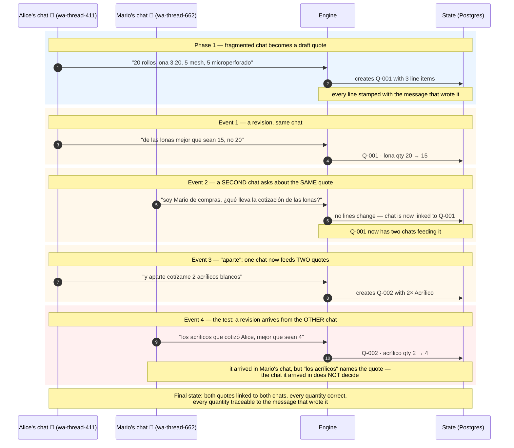
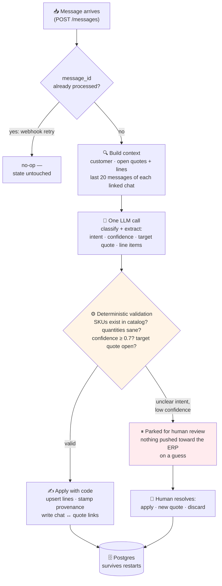
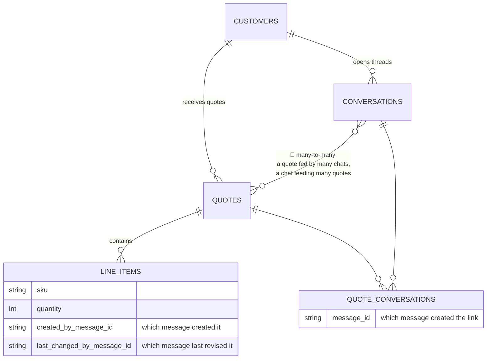
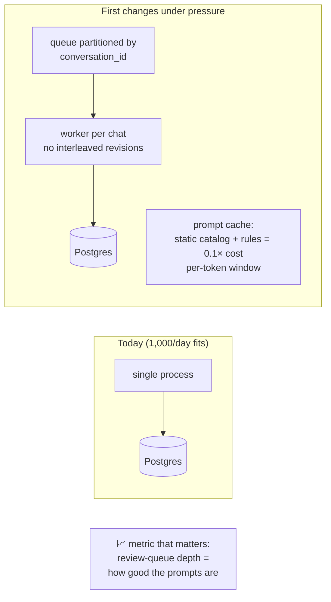

# Presentation diagrams

Renders natively on GitHub. Narrative order: **problem → discipline → design decision**.

---

## 1. The problem, told as it happens (sequence)

*Opening slide. Let the audience feel the trap before any solution talk. The
punchline is step 8: the revision arrives in the wrong chat, and the chat does
not decide — the content does.*

**Presenter notes:** open with Izzy keeping all this "in her head" today; each
numbered arrow is one WhatsApp message. The naive designs die here: a chat
holding a `quote_id` breaks at Event 3; a quote holding a `chat_id` breaks at
Event 2.

---

## 2. The discipline: LLM for meaning, code for state (flowchart)

*The CTO slide. One pipeline, two exits: commit or park. The LLM never writes
state; the validator makes hallucinated SKUs impossible by construction; the
review queue is the "never guess" guarantee.*

**Presenter notes:** the split is the whole argument — *the model understands,
code decides*. Model errors become review items, never corrupt quotes. CEO
framing: the review queue is what makes this deployable — an ambiguous
"mejor cancelalo" never cancels the wrong quote; it asks a human instead.

---

## 3. The design decision that survives all four events (ER)

*Closing slide. Only the tables that matter. The many-to-many is the punchline:
neither obvious shortcut survives, this does — no event needs a workaround.*

**Presenter notes:** the join table carries provenance too — you can answer
"which message linked Mario's chat to Q-001?" The line items keep per-line
message provenance, so a human sees exactly what changed and why. Two shortcuts
both break; the join table means all four events are just rows.

---

## Optional 4th, only if asked about scale

If the CEO/CTO probe on "what happens at 1,000 conversations/day", have this
one ready — but don't lead with it:

Suggested story: cost dominates first (mitigated by prompt-cache shape), then
ordering (one worker per chat), then the review-queue depth metric tells you
when prompts need tuning.
